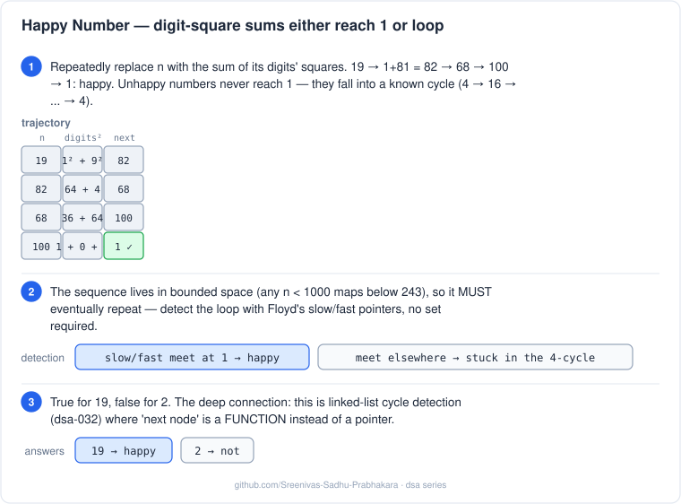

# Happy Number

> NeetCode 150 · Math & Geometry — the digit-square walk either reaches 1 or orbits a cycle; that's linked-list cycle detection wearing arithmetic. Go, stdlib only, tested.

## Problem

Replace n with the sum of its digits' squares, repeatedly. Happy numbers reach 1; unhappy ones loop forever (every one of them eventually orbits through 4). Decide which.

## Approach

The iteration is a functional graph — each number has exactly one successor — so "does it reach 1?" is "does the walk from n hit 1 before entering its cycle?" Floyd's tortoise and hare (dsa-032's algorithm, no pointers required) answers it in O(1) space: the fast walker either lands on 1 or laps the slow one inside the unhappy cycle. A visited-set works too and is what most people write; recognizing that *any* deterministic iteration admits Floyd is the transferable part. Why no walk diverges: a k-digit number's digit-square sum is at most 81k, so everything collapses into a small range quickly.

**Complexity:** effectively O(1) per the bounded range; O(1) space.

## Visual walkthrough

Read the picture top to bottom — each numbered frame is one moment of the algorithm
running on this repo's test example.

## Run

    go test ./...   # verify
    go run .        # demo

---

Part of a 275-repo DSA series in Go — Striver's SDE Sheet (dsa-001–191) plus the NeetCode 150 / Blind 75 additions (dsa-192–275), stdlib only, every solution tested. Browse: [`dsa-*` repos](https://github.com/Sreenivas-Sadhu-Prabhakara?tab=repositories&q=dsa-&type=source).
